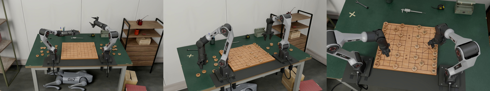

# 松灵 PiPER 双臂摆象棋

<p align="center">
  <a href="https://github.com/Peaceful-World-X/PiPER-Xiangqi/stargazers"></a>
  <a href="https://github.com/Peaceful-World-X/PiPER-Xiangqi"></a>
  
  
  
  
</p>

<p align="center">
  <a href="https://github.com/Peaceful-World-X/PiPER-Xiangqi/releases/latest/download/PiPER-Xiangqi.mp4">
    
  </a>
</p>

<p align="center">
  <a href="https://xhslink.cn/o/3s1Pn5Qqs6K">🎬仿真视频查看</a>
  &nbsp;·&nbsp;
  <a href="https://github.com/Peaceful-World-X/PiPER-Xiangqi/releases">📦仿真视频下载</a>
</p>

- 在 NVIDIA Isaac Sim 中实现松灵 PiPER 双臂抓取、交接和摆放 32 枚象棋的过程，采用运动学回放。
- 场景建模、轨迹拟合、验证和渲染全程在本地 **Windows 11 笔记本（NVIDIA GeForce RTX 4060 Laptop GPU）** 上完成。


## 渲染方式

- **交互预览**使用 RTX Real-Time Legacy，目标为 30 fps，实际帧率取决于硬件和场景负载。
- **视频导出**使用 RTX 路径追踪离线逐帧渲染，成片为 1080p、30 fps、64 秒。

## 运行

- **环境**需要 Windows 版 Isaac Sim 和 64 位 Python 3.12。在项目根目录打开 PowerShell。
- **首次运行**安装依赖并生成场景。
- **实时交互**按空格播放或暂停，拖动时间轴查看动作。
- **视频导出**成片保存到 `renders/PiPER-Xiangqi.mp4`。

```powershell
# 首次安装
python -m venv .venv
.\.venv\Scripts\python.exe -m pip install --index-url https://pypi.org/simple -r requirements.txt
.\.venv\Scripts\python.exe source\build_workshop.py --variant reference
.\.venv\Scripts\python.exe source\verify_rig.py Workshop-shadows.usdc

# 改为本机包含 python.bat 的 Isaac Sim 目录
$env:ISAAC_SIM_PATH = 'C:\isaacsim'

# 实时交互
.\LaunchSimulation.bat --stage Workshop-shadows.usdc

# 可选：导出两秒预览
.\RenderVideo.bat --stage Workshop-shadows.usdc --end 3 --movie renders/test.mp4

# 导出最终成片
.\RenderVideo.bat --stage Workshop-shadows.usdc --frame-cache --movie renders/PiPER-Xiangqi.mp4
```

## 素材

扫描道具来自 Poly Haven，机器人模型来自 MuJoCo Menagerie。 [Poly Haven CC0 许可](https://polyhaven.com/license)

- [开盖金属工具箱](https://polyhaven.com/a/metal_toolbox)
- [3 m 卷尺](https://polyhaven.com/a/measuring_tape_01)
- [文具和笔筒](https://polyhaven.com/a/stationery_supplies)
- [两用扳手](https://polyhaven.com/a/combination_wrench)
- [红色周转筐](https://polyhaven.com/a/plastic_crate_01)
- [长嘴油壶](https://polyhaven.com/a/small_oil_can_01)
- [PiPER 来源](https://github.com/google-deepmind/mujoco_menagerie/tree/370c43965323c0944b433b202aac5058b5f907a9/agilex_piper)
- [Go2 来源](https://github.com/google-deepmind/mujoco_menagerie/tree/370c43965323c0944b433b202aac5058b5f907a9/unitree_go2)
